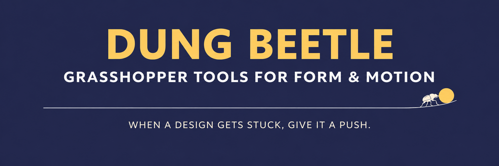

<h1 align="center"></h1>

<p align="center">Dung Beetle brings geometry processing, component alignment, and sliding simulation into Rhino and Grasshopper.</p>

<p align="center">
  <a href="https://github.com/Sucre0903/Dung-Beetle/releases">Releases</a> ·
  <a href="#installation">Installation</a> ·
  <a href="#examples">Examples</a> ·
  <a href="#quick-start">Quick start</a> ·
  <a href="README.md">简体中文</a> ·
  <a href="https://github.com/Sucre0903/Dung-Beetle/issues">Feedback</a>
</p>

---

Dung Beetle brings four focused workflows into Rhino and Grasshopper. Simulate particle motion, approximate curves with circular arcs, unite overlapping planar surfaces, and match congruent planar curves across different positions and orientations in 3D space.

## v1.1 · Spatial Curve Match

**Match shapes, not positions.** Find congruent planar curves across different positions and orientations in 3D, then reuse the resulting rigid transforms to position associated geometry. Designed for component reuse, fabrication-oriented workflows and batch alignment, without scaling or deformation.

[Quick start](#spatial-curve-match) · [Releases](https://github.com/Sucre0903/Dung-Beetle/releases)

## Components

| Component | What it does | Category |
| --- | --- | --- |
|  **Sliding Simulation** | Explore particle motion under gravity, friction and collisions; inspect trajectories, velocities and G-force data. | Physics |
|  **Curve to Biarcs** | Approximate curves with circular arcs and attempt to reduce short segments and tangent discontinuities. Useful for bending and rolling workflows. | Geometry |
|  **Smart Planar Union** | Consolidate overlapping horizontal planar Breps into planar regions, with input membership and diagnostic outputs. | Geometry |
|  **Spatial Curve Match** | Align congruent planar curves in 3D and report the target index, rigid transform and estimated deviation. [Quick start](#spatial-curve-match) | Geometry |

## Examples

Explore Dung Beetle through the accompanying Rhino model and Grasshopper definition.

### Example 01 · Feature Overview

**Download the example files:**

- [Grasshopper definition (.gh)](Dung%20Beetle/Examples/DungBeetle%20Example%2001.gh)
- [Rhino model (.3dm)](Dung%20Beetle/Examples/DungBeetle%20Example%2001.3dm)

Download both files and open them in Grasshopper and Rhino respectively to explore the workflow.

## Installation

**Recommended starting environment: Rhino 8 on Windows with built-in Grasshopper (GH1).**

The project references a Rhino 8 Grasshopper SDK and targets `net7.0-windows`, `net7.0` and `net48`. These build targets do not establish compatibility with every Rhino version, runtime or OS. Other environments require validation.

### Install a release

1. Visit [Releases](https://github.com/Sucre0903/Dung-Beetle/releases). If a compatible binary asset is available, download it, not the automatically generated source ZIP.
2. Extract the archive. On Windows, use Properties → Unblock if the option is present.
3. Open Grasshopper and select **File → Special Folders → Components Folder**.
4. Close Rhino. Copy `Dung Beetle.gha` and any required accompanying runtime dependencies into the components folder, preserving the package layout. Keep only one compatible version of the plugin installed.
5. Restart Rhino, open Grasshopper and look for the **Dung Beetle** tab.

For the Spatial Curve Match preview package on Windows, choose the folder that matches the runtime used by Rhino. Keep the GHA and its accompanying files together.

| Rhino 8 runtime | Folder inside the preview ZIP |
| --- | --- |
| .NET Core | `Install-Windows/net7.0-windows` |
| .NET Framework 4.8 | `Install-Windows/net48` |

If no installable release is available, build the project from source.

### Build from source

Open `Dung Beetle.sln` in Visual Studio 2022, install the SDKs and targeting packs required by the project, restore NuGet dependencies, and build in Release mode. Look in `Dung Beetle/bin/Release/<target framework>/` for the plugin and its required dependencies. Install the build matching the Rhino runtime.

Example command for the existing Windows .NET 7 target:

```powershell
dotnet build ".\Dung Beetle\Dung Beetle.csproj" -c Release -f net7.0-windows
```

The current project references `System.Resources.Extensions 10.0.1`, which may produce compatibility warnings when targeting .NET 7. Validate the selected build inside Rhino before distribution.

## Quick start

These are suggested manual test setups, not bundled Grasshopper definitions.

### Sliding Simulation

Search for `Sliding_SimulationComponent` or `滑行物理模拟 v61.2` under Dung Beetle → Physics.

Create a sloping Brep in a millimetre-based Rhino model and place a start point near its upper end. Connect the Brep to `Obs` and the point to `Pts`. Try `R=10`, `F=0.45`, `Drop=True`, `Col=False`, `T=10`, `dt=0.02`, with zero initial velocity.

| Inputs | Purpose |
| --- | --- |
| `Obs`, `Pts` | Collision Breps and particle start points |
| `Vel`, `R`, `F`, `E`, `D` | Initial velocity (m/s), radius (mm), friction, restitution and delay (s) |
| `Drop`, `Col` | Automatic drop and inter-particle collisions |
| `T`, `dt` | Duration and time step (s) |

| Outputs | Purpose |
| --- | --- |
| `msg` | Diagnostic report, when available |
| `X`, `Traj` | Per-particle transformations and trajectories |
| `V`, `S`, `G` | Velocity vectors (m/s), speed (m/s) and G-force indicators |

Use `Col=False` for independent trajectories; use `Col=True` with multiple particles to explore mutual collisions. Restitution is passed to the multi-particle collision engine. The model assumes millimetre-based geometry internally.

### Curve to Biarcs

Search for `Curve to Biarcs` or `Crv2Arcs` under Geometry.

Create a smooth S-shaped curve several thousand millimetres long. Connect it to `C` and try `Tol=1`, `Ang=5`, `MaxL=1000`, `MinL=100`, and `Res=50`. Inspect the arcs and their deviation and joint-angle outputs; try `O_K=True` if unacceptable kinks remain.

| Inputs | Purpose |
| --- | --- |
| `C`, `Tol`, `Ang` | Curve, fitting tolerance (model units), kink threshold (degrees) |
| `MaxL`, `MinL`, `Res` | Maximum/minimum arc length targets and sampling resolution |
| `Seam`, `Dir`, `Mid` | Seam, direction and midpoint optimisation |
| `O_S`, `O_K`, `Iter` | Short-arc optimisation, kink repair and iteration count |

| Outputs | Purpose |
| --- | --- |
| `A`, `Dev`, `Tan`, `DL` | Arcs, estimated deviations, start tangents and deviation lines |
| `Msg`, `S_Arc` | Report and residual short arcs |
| `J_Pt`, `J_Ang` | Joint positions and angles in degrees |
| `K_Pt`, `K_Ang`, `Dbg` | Remaining kinks, their angles, and diagnostic curve fragments |

Tolerance, arc lengths and smoothness are optimisation targets, not guaranteed constraints. Review the outputs before fabrication.

### Smart Planar Union

Search for `Smart Planar Union` or `PlanarUnion` under Geometry.

Draw three overlapping closed contours on World XY and create single-face planar Breps using Boundary Surfaces. Flatten the input to `S`, set `Tol=0.01`, then set `Run=True`. Hide input preview to inspect the resulting `Top` regions.

| Port | Purpose |
| --- | --- |
| `S` | Horizontal, single-face planar Breps at the same Z elevation |
| `Tol` | Boolean / join tolerance in model units (default 0.01) |
| `Run` | Start computation (default False) |
| `Top` | Reconstructed planar Breps |
| `Groups` | Zero-based source indices, one branch per final solid union group |
| `Failed` | Rejected input Breps |
| `Log` | Chinese diagnostic summary |

Internally the algorithm extrudes, unions, extracts, joins and attempts to merge faces. `Top` and `Groups` are not guaranteed to correspond item by item. For tilted coplanar surfaces, transform them to World XY first, then transform the output back. This is not a general 3D solid union tool.

### Spatial Curve Match

Search for `Spatial Curve Match` or `SpaceMatch` under Dung Beetle → Geometry.

Draw an asymmetric closed polyline on World XY. Make a copy, rotate the copy around the world X axis, then move it. Connect the original to `S`, the copy to `T`, and set `Tol=0.01` in model units. Check that `I=0`, `OK=True`, and the aligned curve at `C` overlaps the target.

Both inputs accept planar curves, and each curve can lie in a different plane. Open curves match open curves, and closed curves match closed curves. The component finds a rotation and translation from the source pose to the target pose.

| Inputs | Purpose |
| --- | --- |
| `S`, `T` | Source curves and candidate target curves |
| `Tol`, `N` | Matching tolerance in model units and sample count. Defaults are the Rhino document tolerance and 96 samples. |
| `Flip` | Try rotations based on the opposite target plane normal. Enabled by default. |
| `Unique` | Assign each target index at most once per solve. Enabled by default. |

| Outputs | Purpose |
| --- | --- |
| `I`, `OK` | Zero-based target index and match status. Unmatched sources return `-1` and `False`. |
| `X`, `C` | Rigid transform and aligned copy of the source curve |
| `Dev`, `Log` | Estimated maximum deviation in model units and diagnostic details |

The match outputs follow the source list order. Filter by `OK` and use `X` with Grasshopper's **Transform** component to align geometry associated with the source curves. To search across all branches in a single solve, flatten both `S` and `T`.

[Detailed usage guide in Simplified Chinese](docs/Spatial-Curve-Match.zh-CN.md)

## Notes and troubleshooting

- Plugin not visible: check the component folder, Windows file blocking, runtime compatibility, required dependencies and duplicate installations. Restart Rhino after replacement.
- Yellow component: inspect its diagnostic outputs; results may require review.
- Slow computation: reduce the test input size first. Smart Planar Union is synchronous, and its internal search budget is not a hard timeout for individual Boolean operations.
- Simulation results are exploratory indicators, not proof of ride or human safety. Validate fabrication geometry and engineering results independently.
- The UI includes Chinese tooltips and reports; English documentation is provided here for reference.

## Feedback

Developed by **Suke**. If Dung Beetle helps with your Grasshopper workflow, consider starring the repository or sharing a use case.

[Report a bug or request a feature](https://github.com/Sucre0903/Dung-Beetle/issues). Please include your Rhino version, OS, plugin version, input geometry, parameters and diagnostic output, with confidential information removed.

The project is under development. The current source snapshot has no explicit LICENSE file; contact the author about licensing and redistribution.
